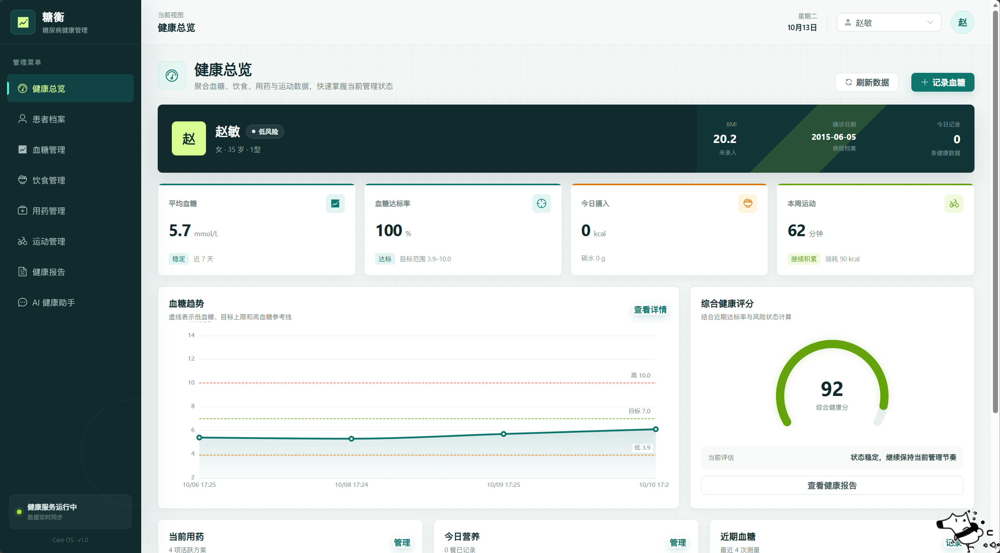
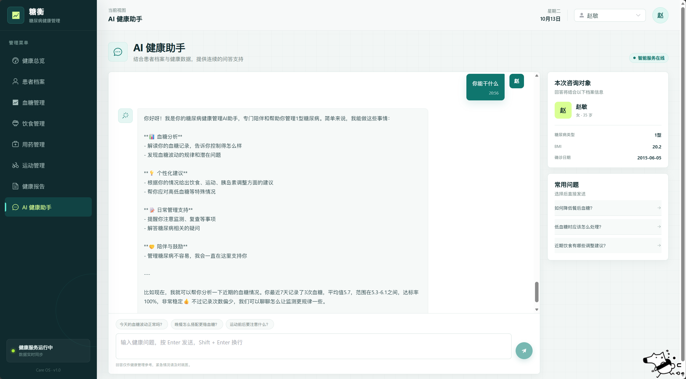
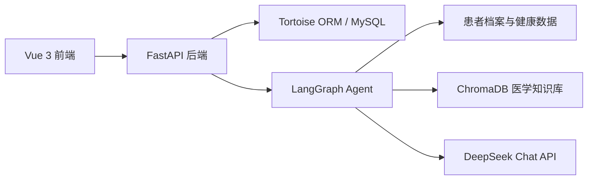

# 糖衡 - 糖尿病 AI 健康管理系统

一个面向糖尿病患者的全栈健康管理平台，覆盖患者档案、血糖、饮食、用药、运动、健康报告和 AI 问答等核心场景。系统结合患者健康数据与医学知识库，通过 LangGraph、RAG 和大语言模型生成个性化健康建议。

## 项目亮点

- 完整的患者健康档案与多维度数据管理
- 血糖趋势、达标率、健康评分和营养结构可视化
- 饮食 GI、用药方案和运动记录统一管理
- 基于 LangGraph 的 AI 健康助手工作流
- 结合患者档案、近期血糖与医学知识库生成回答
- 前后端分离，支持完整的本地开发流程

## 页面效果

### 健康总览



### AI 健康助手



## 功能模块

| 模块        | 主要功能                                                 |
| ----------- | -------------------------------------------------------- |
| 健康总览    | 患者概况、平均血糖、达标率、饮食摄入、运动时长、健康评分 |
| 患者档案    | 患者信息管理、疾病类型、BMI、病史与过敏信息              |
| 血糖管理    | 血糖记录、趋势分析、达标统计与风险提示                   |
| 饮食管理    | 饮食记录、热量与三大营养素统计、GI 分析与膳食推荐        |
| 用药管理    | 用药计划、剂量、频次、服用时间和状态管理                 |
| 运动管理    | 运动记录、时长、消耗热量与周运动趋势                     |
| 健康报告    | 基于健康数据生成阶段性健康报告                           |
| AI 健康助手 | 结合患者数据、医学知识库和 LLM 提供连续健康问答          |

## AI 实现架构



AI 问答流程：

1. 识别用户问题类型
2. 读取患者档案与近期血糖数据
3. 从 ChromaDB 医学知识库检索相关内容
4. 通过 LangGraph 编排上下文并调用大语言模型
5. 结合风险等级生成最终健康建议

## 技术栈

| 层级   | 技术                                                                     |
| ------ | ------------------------------------------------------------------------ |
| 前端   | Vue 3、TypeScript、Vite、Pinia、Vue Router、Element Plus、ECharts、Axios |
| 后端   | Python、FastAPI、Tortoise ORM、Pydantic、MySQL、Uvicorn                  |
| AI     | LangChain、LangGraph、ChromaDB、HuggingFace Embeddings、DeepSeek         |
| 工程化 | uv、Yarn、Git                                                            |

## 项目结构

```text
medical_system/
|-- backend/
|   |-- app/
|   |   |-- core/          # LLM、LangGraph、RAG、健康分析等核心逻辑
|   |   |-- models/        # Tortoise ORM 数据模型
|   |   |-- routers/       # FastAPI 路由
|   |   |-- schemas/       # 请求与响应模型
|   |   `-- config.py      # 数据库配置
|   |-- main.py
|   |-- pyproject.toml
|   |-- uv.lock
|   `-- .env.example
|-- frontend/
|   |-- src/
|   |   |-- api/
|   |   |-- components/
|   |   |-- router/
|   |   |-- stores/
|   |   |-- styles/
|   |   |-- types/
|   |   |-- utils/
|   |   `-- views/
|   |-- index.html
|   |-- package.json
|   |-- tsconfig.json
|   |-- vite.config.ts
|   `-- yarn.lock
`-- docs/
    `-- images/
```

## 本地启动

### 环境要求

- Python 3.12+
- Node.js 18+
- Yarn
- MySQL 8.0+
- 可用的 DeepSeek API Key

### 1. 启动后端

```powershell
cd backend
uv sync
Copy-Item .env.example .env
```

在 `backend/.env` 中填写 MySQL 和模型配置，然后启动服务：

```powershell
uv run python -m uvicorn main:app --reload --port 8000
```

后端接口文档：

```text
http://127.0.0.1:8000/docs
```

### 2. 启动前端

```powershell
cd frontend
yarn install
yarn dev --port 3000 --strictPort
```

前端访问地址：

```text
http://localhost:3000/
```

前端通过 Vite 将 `/api` 请求代理到 `http://127.0.0.1:8000`。

## 环境变量

后端使用 `backend/.env` 管理本地配置。可以参考 `backend/.env.example`，不要提交真实密钥。

| 变量                       | 说明                                               |
| -------------------------- | -------------------------------------------------- |
| `DB_HOST`                | MySQL 地址                                         |
| `DB_PORT`                | MySQL 端口                                         |
| `DB_USER`                | MySQL 用户名                                       |
| `DB_PASSWORD`            | MySQL 密码                                         |
| `DB_NAME`                | 数据库名称                                         |
| `LLM_API_KEY`            | 大语言模型 API Key                                 |
| `LLM_BASE_URL`           | 模型服务基础地址，例如`https://api.deepseek.com` |
| `LLM_MODEL`              | 模型名称，例如`deepseek-chat`                    |
| `LLM_TEMPERATURE`        | 模型温度                                           |
| `LLM_MAX_TOKENS`         | 最大输出 Token 数                                  |
| `BG_LOW_THRESHOLD`       | 低血糖阈值                                         |
| `BG_HIGH_THRESHOLD`      | 高血糖阈值                                         |
| `HF_ENDPOINT`            | HuggingFace 下载地址                               |
| `CHROMA_PERSIST_DIR`     | ChromaDB 持久化目录                                |
| `CHROMA_COLLECTION_NAME` | 医学知识库集合名称                                 |
| `RAG_TOP_K`              | RAG 检索返回条数                                   |

## 主要接口

| 接口                 | 说明                     |
| -------------------- | ------------------------ |
| `/api/patients`    | 患者档案管理             |
| `/api/blood-sugar` | 血糖记录与统计           |
| `/api/diet`        | 饮食记录、营养汇总与推荐 |
| `/api/exercise`    | 运动记录                 |
| `/api/medication`  | 用药管理                 |
| `/api/reports`     | 健康报告                 |
| `/api/chat`        | AI 健康助手与聊天历史    |
